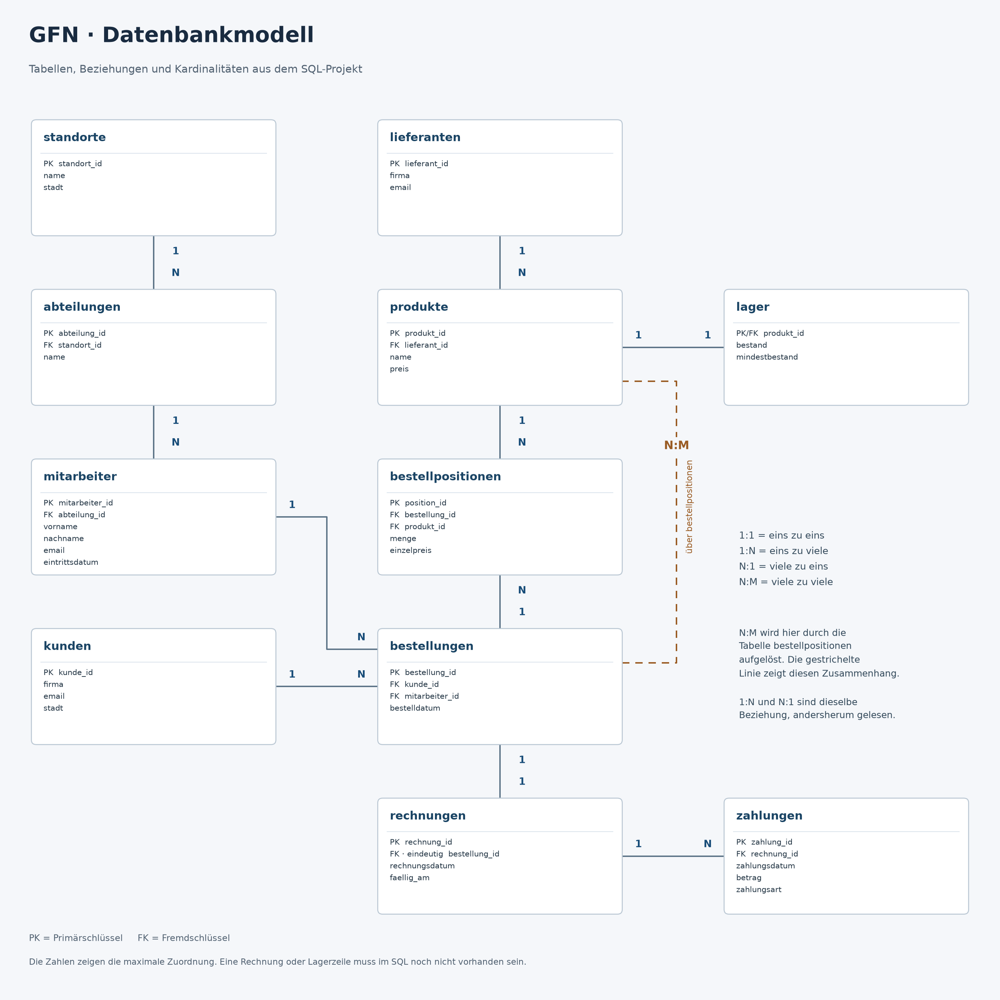

GFN Unternehmensverwaltung

Version 1.0.9

Unser heutiges Projekt

Unser heutiges Projekt war eine Unternehmensverwaltung mit MySQL. Dafür haben wir GFN als Beispiel genommen. Die Namen, Daten und Abläufe sind ausgedacht.

Die Aufgabenstellung

Wir sollten eine Datenbank für ein Unternehmen planen und erstellen. Die Aufgabe war für neun Teilnehmer und zwei Projekttage gedacht. Fertige Lösungen oder SQL-Befehle waren nicht vorgegeben.

Die Bereiche waren Planung und Datenbankstruktur, Mitarbeiter, Abteilungen, Kunden, Produkte, Bestellungen, Rechnungen, Lieferanten und Lager sowie Zahlungen.

Jeder sollte seine Tabellen selbst planen, passende Datentypen auswählen und Primärschlüssel sowie die nötigen Fremdschlüssel festlegen. Dazu gehörten mindestens zehn Beispieldatensätze und fünf eigene SQL-Abfragen pro Teilnehmer. Die Tabellen sollten anschließend miteinander verbunden, getestet und dokumentiert werden.

Am ersten Tag waren die Planung und der Aufbau dran. Für den zweiten Tag waren Beispieldaten, Abfragen, gemeinsame Tests und eine kurze Präsentation vorgesehen.

Am Ende sollte die Datenbank diese Fragen beantworten können:

- Welche Mitarbeiter gehören zu welchen Abteilungen?
- Welche Produkte müssen nachbestellt werden?
- Welche Rechnungen sind noch offen?
- Wie hoch ist der monatliche Umsatz?
- Welche Produkte werden besonders häufig bestellt?
- Welche Kunden haben Bestellungen aufgegeben?

Zur Abgabe gehörten die Tabellenstruktur, eine SQL-Erstellungsdatei, Beispieldaten, die eigenen Abfragen, eine Dokumentation der Beziehungen und eine kurze Vorstellung der Arbeit.

Unsere Umsetzung

Unsere Datenbank enthält 11 Tabellen, 120 Beispieldatensätze und 45 Abfragen. Als Produkte verwenden wir Lernhefte und Schulungsunterlagen. Firmenkunden können diese bestellen. Dazu lassen sich Rechnungen und Zahlungen erfassen.

Dokumentation und Datenbankmodell

Die [Dokumentation](Dokumentation_GFN.md) erklärt kurz, wie die Datenbank aufgebaut ist. Das Diagramm zeigt die Tabellen mit ihren Schlüsseln und Beziehungen.

Updates

Ich hatte die automatisch vergebenen IDs in den Beispieldaten von Hand eingetragen. Das war mein Fehler. Jetzt vergibt die Datenbank sie beim Einfügen selbst.

Erstellt von [PalescoDev](https://github.com/PalescoDev).
